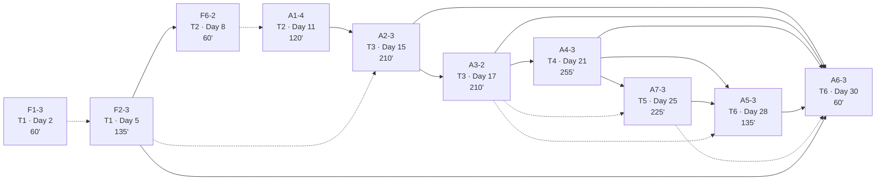

# Chuỗi lab SM-WEB – đầu ra lab trước → đầu vào lab sau

> Sinh từ `lab_chain.json` – không sửa tay. Nét liền = bắt buộc, nét đứt = khuyến nghị.

## Bảng nối chi tiết

| Lab sau | Từ lab | File chuyển giao | Mức | Mục đích |
|---|---|---|---|---|
| F2-3 | F1-3 | `F1-3/conclusion.md` | Khuyến nghị | Bài học F1-3 (biến thiên, hallucination khi thiếu ngữ cảnh) → luôn đưa đoạn SRS vào prompt, cố định config để tái lập. |
| F2-3 | F2-1 | `prompts/PROMPT_LIBRARY.md` | Khuyến nghị | 2 prompt có version + change log từ bài F2-1 (PR-F2-001 v1.0 → v1.1) là điểm xuất phát. |
| F6-2 | F2-3 | `F2-3/notebook/F2_prompt_chain.py` | Khuyến nghị | LevelUp mô tả task = chuỗi F2-3 của học viên; starter F6_cost_guardrail.py v1.0 (đang dùng) đo bằng prompt gộp TASK trên cùng fixture – ghi rõ trong prompt_record.md. |
| F6-2 | F2-3 | `prompts/PROMPT_LIBRARY.md` | Bắt buộc | Ghi prompt/version dùng để đo trên 2 model. |
| F6-2 | F2-3 | `F2-3/AI_Output_Evaluation.md` | Khuyến nghị | Cách đo schema/REQ phủ/hallucination/tái lập của F2-3 dùng lại cho điểm chất lượng. |
| A1-4 | F6-2 | `F6-2/F6_Model_Quality_Cost.csv` | Khuyến nghị | Gợi ý (không bắt buộc theo lab guide): dùng model đã chọn ở F6-2 và giữ guardrail cho các lab A. |
| A1-4 | A1-1 | `evidence/EVIDENCE_INDEX.md` | Khuyến nghị | Checklist truy cập UAT/API/Swagger (A1-1) đã hoàn thành; repo cá nhân đã tạo. |
| A2-3 | A1-4 | `A1-4/A1_Review_Log.csv` | Bắt buộc | Review log ĐÃ FIX COMMENT: mâu thuẫn/mơ hồ đã làm rõ (vd ngưỡng free ship REQ-SF-15) quyết định condition và expected. |
| A2-3 | A1-4 | `A1-4/Test_Plan.md` | Khuyến nghị | Ưu tiên/độ sâu theo rủi ro → chọn kỹ thuật và mức Cao cho REQ. |
| A2-3 | F2-3 | `prompts/PROMPT_LIBRARY.md` | Khuyến nghị | Tái dùng khung prompt sinh condition JSON (PR-F2-02) làm gốc cho prompt theo từng kỹ thuật. |
| A3-2 | A2-3 | `A2-3/A2_Test_Design_Coverage.csv` | Bắt buộc | Test condition A2-3 BẢN ĐÃ FIX COMMENT (đã bổ sung condition thiếu so benchmark) – mỗi TC phải trỏ về condition_id. |
| A4-3 | A3-2 | `A3-2/reviewed/T02_Test_Case.csv` | Bắt buộc | Chọn 10 TC ưu tiên cao đã review; tên test bắt đầu bằng TC ID (vd TC-SF04-01) để truy vết. |
| A4-3 | A3-2 | `A3-2/A3_Traceability_Matrix.csv` | Khuyến nghị | Điền cột automated_ui_id cho 10 TC được tự động hóa. |
| A7-3 | A4-3 | `A4-3/stability_runs.csv` | Bắt buộc | API suite đưa vào CI CÙNG suite UI của A4-3 – workflow CI phải đang chạy ổn định. |
| A7-3 | A3-2 | `A3-2/A3_Traceability_Matrix.csv` | Khuyến nghị | Điền cột automated_api_id cho REQ-API/REQ-SF-31 để traceability phủ cả API. |
| A5-3 | A4-3 | `A4-3/automated_tc.csv` | Bắt buộc | Chạy suite UI của A4-3 trên bản with-bugs để phát hiện lỗi. |
| A5-3 | A7-3 | `A7-3/api_tc_list.csv` | Bắt buộc | Chạy suite API của A7-3; request/response làm bằng chứng RCA. |
| A5-3 | A3-2 | `A3-2/A3_Traceability_Matrix.csv` | Khuyến nghị | Gắn bug với REQ/TC (điền cột bug_id) để test summary nêu được phạm vi ảnh hưởng. |
| A6-3 | A2-3 | `A2-3/time_log.csv` | Bắt buộc | KPI design time. |
| A6-3 | A2-3 | `A2-3/coverage_summary.md` | Bắt buộc | KPI benchmark coverage (v2). |
| A6-3 | A3-2 | `A3-2/A3_Review_Decision_Log.csv` | Bắt buộc | KPI acceptance rate (định nghĩa 1.4). |
| A6-3 | A4-3 | `A4-3/time_log.csv` | Bắt buộc | KPI automation time (10 TC đạt chuẩn ổn định). |
| A6-3 | A5-3 | `A5-3/defect_analysis_time.csv` | Bắt buộc | KPI defect analysis time. |
| A6-3 | A7-3 | `A7-3/time_log.csv` | Khuyến nghị | Bổ sung (tùy chọn) dữ liệu automation API. |
| A6-3 | F2-3 | `prompts/PROMPT_LIBRARY.md` | Bắt buộc | Prompt library v1 → nâng lên v2. |

## File dùng chung xuyên chuỗi

| File | Ai ghi | Ghi gì |
|---|---|---|
| `prompts/PROMPT_LIBRARY.md` | F2-3 (v1) → A2-3… (bổ sung) → A6-3 (v2) | Prompt có version, change log |
| `A3-2/A3_Traceability_Matrix.csv` | A3-2 (REQ↔condition↔TC) → A4-3 (`automated_ui_id`) → A7-3 (`automated_api_id`) → A5-3 (`bug_id`) | Truy vết xuyên suốt tới đồ án |
| `*/time_log.csv`, `A5-3/defect_analysis_time.csv` | A2-3, A3-2, A4-3, A7-3, A5-3 | Dữ liệu thô cho 5 KPI ở A6-3 |
| `evidence/EVIDENCE_INDEX.md` | Mọi lab | Link commit nộp + commit fix comment |
| `F3_AI_Usage_Escalation_Log.csv` | Mọi lab (mở từ F3-1) | Tình huống dữ liệu/escalation |
